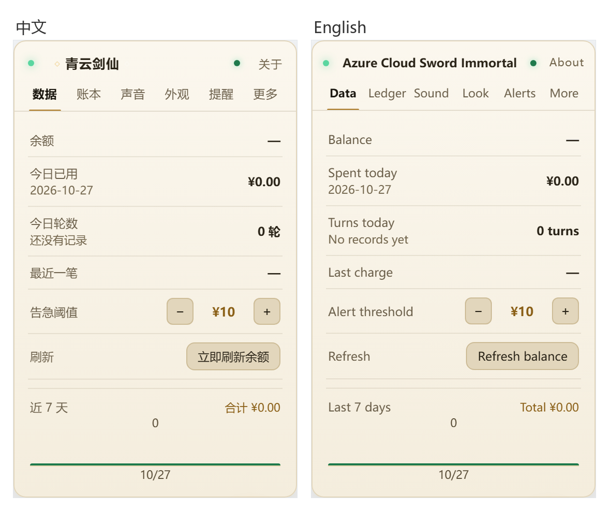
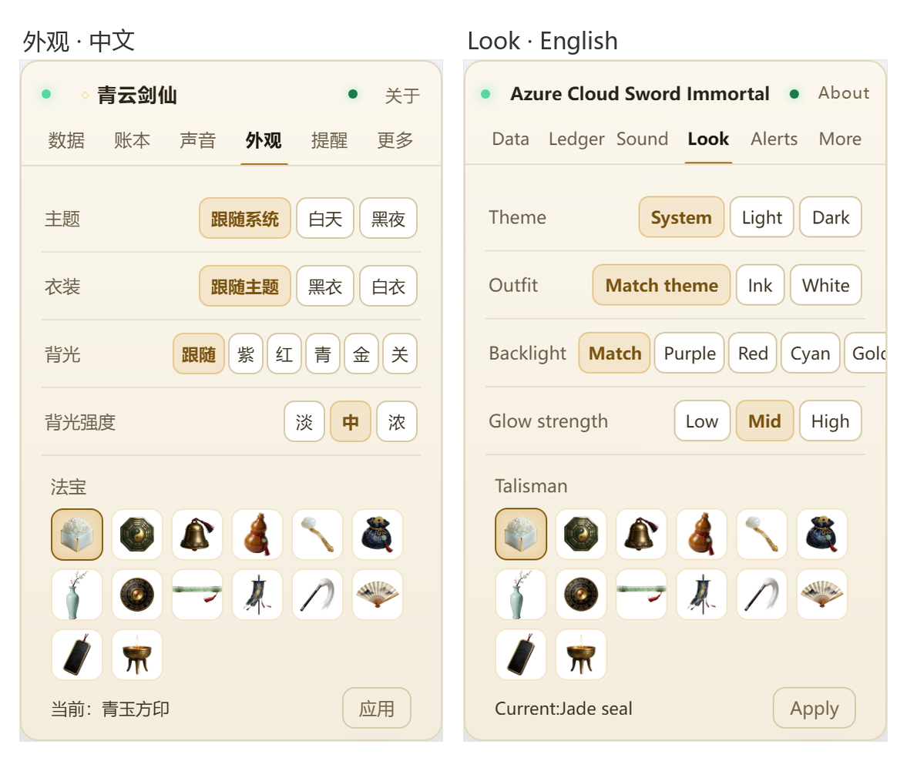

# Azure Cloud Sword Immortal (青云剑仙)

> Chinese: [青云剑仙](README.md)

> A resident widget for the bottom-right corner of your screen: a white-haired sword immortal
> who flies on his blade, guards the furnace, reminds you to drink water — and tells you to
> spend less when your balance drops.

<p align="center">
  
</p>

One frontend, two shells:

| Form | Where it lives | What it knows |
|---|---|---|
| **DSH plugin** | DeepSeek Harness Web UI | balance, ledger, per-turn cost, question/approval alerts |
| **Userscript** | Tampermonkey / Violentmonkey, any site | character, bubbles, reminders, peak/off-peak — no balance |

<p align="center">
  
</p>

<p align="center">
  
</p>

## Install

### Userscript (fastest)

1. Install [Tampermonkey](https://www.tampermonkey.net/).
2. Open the raw URL of `dist/xjj.user.js` (Tampermonkey offers to install), or paste the file
   into a new script.
3. Any page: the character shows up bottom-right. Click him for a bubble, click the **talisman**
   for the panel.

Narrow it to specific sites by editing the header:

```js
// @match        https://chat.deepseek.com/*
```

React 18.3.1 is loaded once via `@require` (jsdelivr); afterwards it comes from browser cache.

**Language**: one artifact, switches automatically — the DSH build follows the host locale
(`ctx.locale`), the userscript follows the browser language (`navigator.language`). Translations live in
`src/i18n/en.json` (302 entries); at build time Chinese string literals are wrapped as `__xjjT('…')`
and resolved at runtime.

```bash
node check-i18n.mjs    # coverage guard: fails if any Chinese string has no translation
```

### DSH plugin

```bash
dsh plugin --profile desktop add /abs/path/dsh-jianxian-widget-4.16.0.tgz
# or link straight to the source folder
dsh plugin --profile desktop add /abs/path/plugin
```

Host-side changes need a client restart; frontend-only changes just need `Ctrl+F5`.

## Features

- **23 standing poses** + **24-frame sword dance**, **14 talismans**, **10 sound effects**
  (each switchable), 6-tab panel.
- Bubble system: click sequence, variants, weighted random, per-line styles, **visual editor**.
- Click him 5 times within 3 seconds → he flies a lap around the screen (~6 s).
- Accounting (DSH only): balance with four colour bands, today's spend, average per turn,
  7-day bar chart, searchable ledger.
- Reminders: low balance, per-turn cost, pending question/approval, daily budget, late-night,
  hydration/eye-rest.

> No agent tools are registered, no tokens consumed. It's just a widget.

## Outfit & backlight

The Look tab switches the robe and the glow behind the character independently, and only affects the
widget itself — the DSH appearance settings are never touched.

**Outfit** (`ui.outfit`)

| Value | Effect |
|---|---|
| `auto` (default) | White robe by day, ink robe by night, following the theme |
| `ink` | Always the ink robe |
| `white` | Always the white robe |

The white set covers all 23 standing poses (moon-white robe, silver trim, pale ice-blue inner collar,
ivory scabbard and hilt, white boots). Both outfits now carry their own 24-frame sword dance, so
switching outfit switches the dance too (the two choreographies are close but not identical).

**Backlight** (`ui.glow` / `ui.glowAlpha`)

| Setting | Options |
|---|---|
| Colour | Match outfit (purple on ink, red on white), purple, red, cyan, gold, off |
| Strength | Low 0.35 / Mid 0.65 / High 0.9 |

The backlight is a `drop-shadow` that follows the silhouette — hair, sleeves and sword all pick up the
glow — instead of a disc behind the character.

## Privacy

- **No telemetry.** No analytics, no beacons. The only outbound request is to
  `api.deepseek.com` when you actively refresh the balance (DSH build).
- **Balance stays local.** Read from `DEEPSEEK_API_KEY` credentials, or the DSH account session.
  Keys are never forwarded to third parties.
- **Writes are local-only.** `POST /xjj/config.json` requires the `x-xjj-write: 1` header *and*
  a loopback Host + peer address, which blocks CSRF and DNS rebinding.
- **Userscript**: no network requests after the React CDN load; config lives in `localStorage`.

## Compatibility

| | |
|---|---|
| DSH | requires the host `webServer` service; `credentials` / `deepseekAccount` are optional |
| Browser | recent Chrome / Edge / Firefox (React 18, `localStorage`, `Response`) |
| Build | Node ≥ 18, Python ≥ 3.9 (stdlib only) |
| OS | developed and verified on Windows; the host half is plain Node with no platform branches, macOS/Linux untested |

## Build & verify

```bash
npm run build     # plugin/client.js + dist/xjj.user.js
npm run build:web # web userscript only
npm test          # eight guard suites, ~1 min
```

> `python` in these scripts means Python 3.9+. On macOS / Linux with only `python3`,
> run `python3 build.py --target all`, or replace `python` with `python3` in `package.json`.

Guards: copy/number consistency, i18n coverage (source + built bundle), config-merge
coverage, structural completeness, static audit of the guards themselves, 45 route/write-fence
assertions, 28 billing assertions, and 11 mutants that must turn the guards red.

Real-browser smoke tests (Playwright + Chromium):

```bash
python -m http.server 8791 --bind 127.0.0.1
python verify/web_smoke.py     # 8 checks
python verify/dsh_smoke.py     # 4 checks
```

## Layout

```
build.py              one template → two shells (asset inlining, version stamping, shell swap)
src/client.template.js  the only frontend source (2522 lines; last 30 are DSH wiring)
src/host.web.js       userscript host shim: 6 /xjj/*.json endpoints over localStorage
plugin/               DSH package (host index.js + generated client.js)
assets/               poses / talismans / sounds, inlined at build time
dist/xjj.user.js      userscript artifact
verify/               browser smoke harness
```

## Known limitations

- Sword-flight duration (6 s) and the 5-click window (3 s) are hard-coded.
- Bubble styling is per-line, not per-module; reordering means delete + re-add.
- No drag sorting in the editor; random-module weights are forced to 1.
- `sword` / `wipe` key names are swapped relative to the artwork (display names are corrected).
- Userscript: no balance/ledger (`—`), and strict CSP sites may block the inline `<style>`.
- Only models present in the price table (`deepseek-flash`, `deepseek-v4-pro`, plus old-name aliases)
  are priced. Anything else — including the same model name served by a third-party gateway — records
  tokens but no money, and the bubble says "未计价". Deliberate: no number beats a wrong number.
- The public-holiday table covers 2026 only. Until the State Council publishes 2027, holidays are
  treated as workdays; the host warns once a day and the self-check panel shows a hint.

## License

- **Code**: [MIT](LICENSE)
- **Art assets**: not MIT — see [LICENSE-ASSETS](LICENSE-ASSETS)
- Third-party notices: [NOTICE.md](NOTICE.md)

## Versions

See [CHANGELOG.en.md](CHANGELOG.en.md) (Chinese: [CHANGELOG.md](CHANGELOG.md)).

[中文说明](README.md) · [CHANGELOG](CHANGELOG.md)
