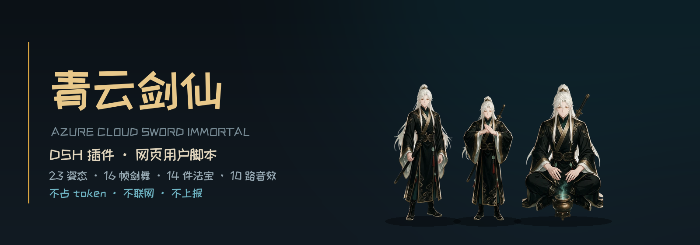
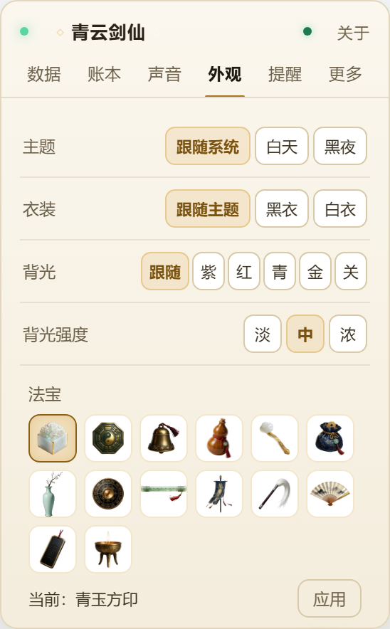
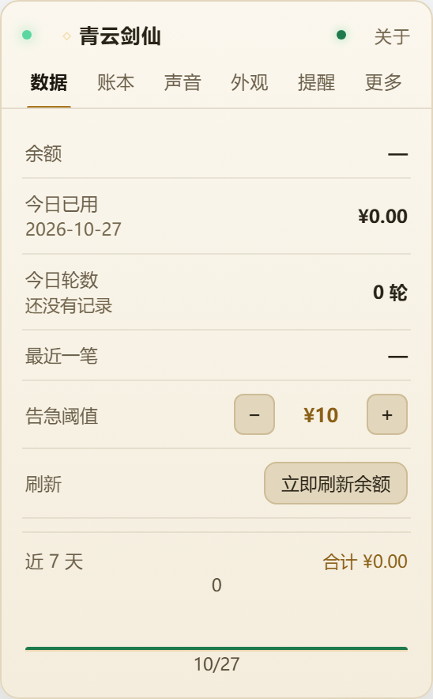
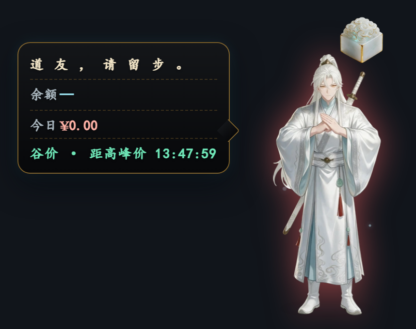
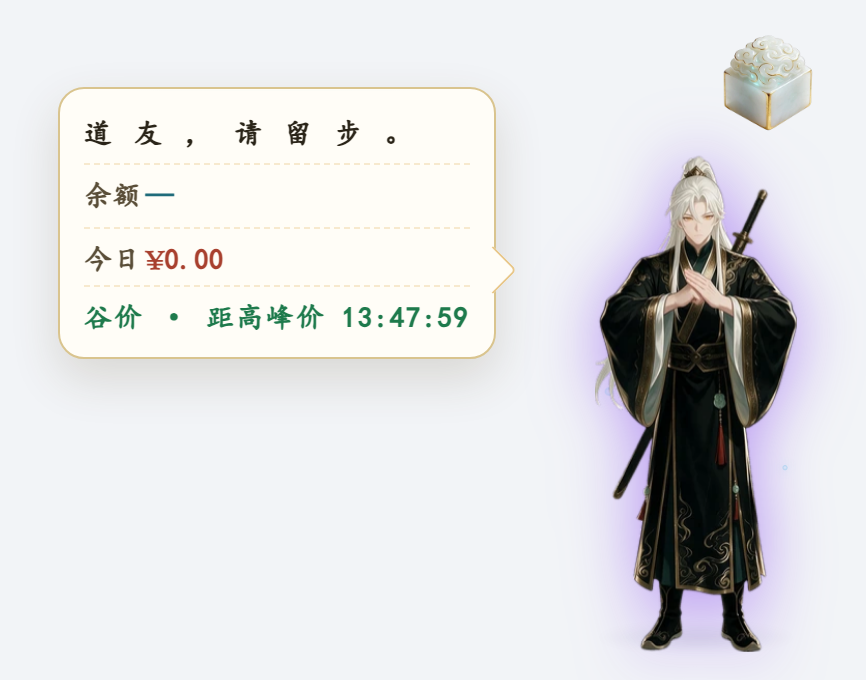
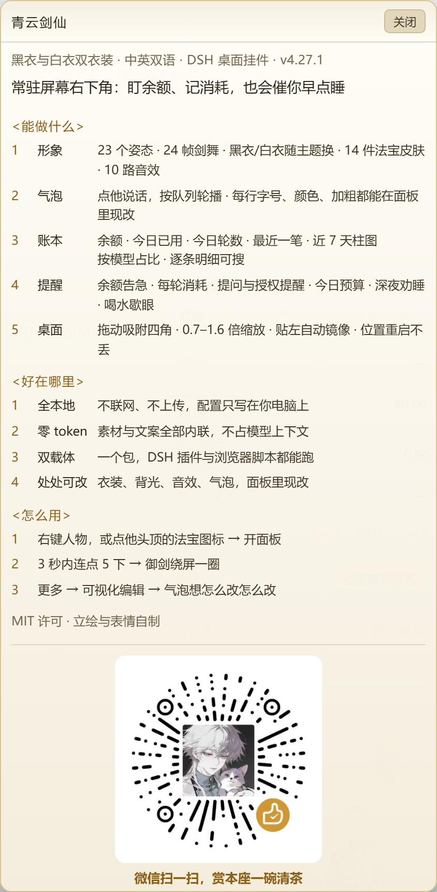
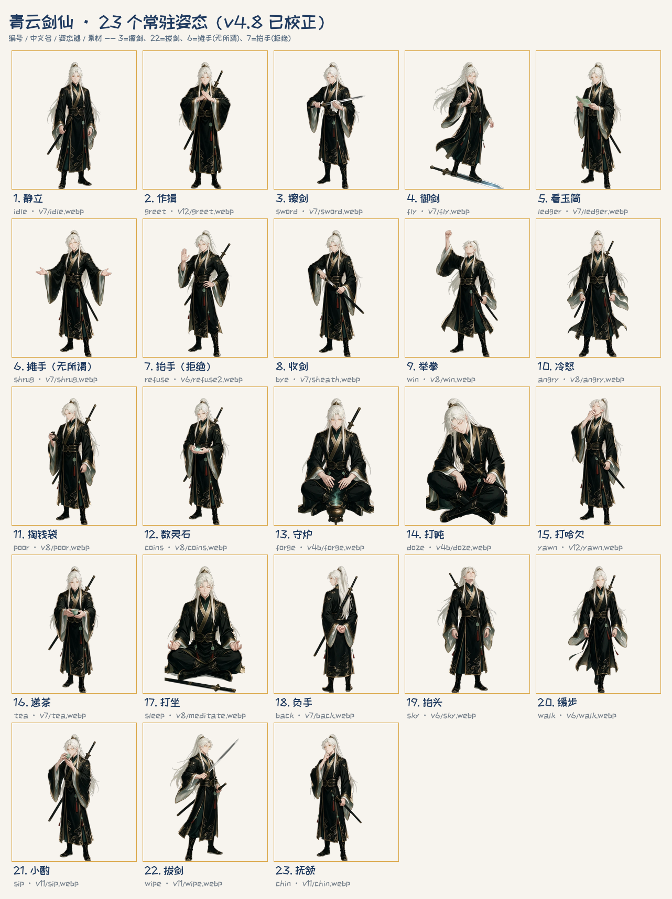

# 青云剑仙

> DSH 网页界面和任意网页右下角的常驻挂件：白发墨金的剑修大师兄。
> 会御剑、会守炉、会催你喝水，也会盯着你的余额说"省着点用"。

<p align="center">
  
</p>

一套前端，两个壳：

| 形态 | 装在哪 | 数据 |
|---|---|---|
| **DSH 插件** | DeepSeek Harness 的 Web 界面（右下角常驻） | 余额、账本、每轮消耗、提问提醒——全套 |
| **网页用户脚本** | Tampermonkey / Violentmonkey，任何网页 | 人物、气泡、提醒、峰谷——不读余额 |

<p align="center">
  
  
</p>

## 装

### 一、网页版（最省事）

1. 浏览器装 [Tampermonkey](https://www.tampermonkey.net/)（或 Violentmonkey）。
2. 打开 `dist/xjj.user.js` 的 raw 地址 → Tampermonkey 会自动弹出安装页；或者新建脚本、把文件内容整个粘进去。
3. 打开任意网页，右下角出现人物。点人物冒泡，点**法宝**开面板。

只想在常去的站点跑，把头部 `@match *://*/*` 改窄即可：

```js
// @match        https://chat.deepseek.com/*
```

网页版首次运行要联网拉两遍 React 18.3.1（`@require` 里的 jsdelivr），之后走浏览器缓存。

**语言**：同一份产物，**跟随环境自动切换** —— DSH 版看宿主语言设置（`ctx.locale`），网页版看浏览器语言
（`navigator.language`）。译文表在 `src/i18n/en.json`（302 条），构建时把带中文的字符串字面量包成
`__xjjT('…')`，运行时按当前语言查表；中文原样返回。

```bash
node check-i18n.mjs    # 覆盖率守卫：源码里有中文没译文就失败
```

### 二、DSH 插件

```bash
# 1) 从 npm 装（推荐，一条命令；之后 `dsh plugin ... update` 就能升级）
dsh plugin --profile desktop add dsh-jianxian-widget

# 2) 或用 release 里的插件包
dsh plugin --profile desktop add /绝对路径/dsh-jianxian-widget-4.16.0.tgz

# 3) 或直接从源码目录 link 安装
dsh plugin --profile desktop add /绝对路径/plugin
```

然后在 profile 的 `package.json` 里确认两处（插件包自带 `cordis.patch.yml`，正常会自动写入）：

```jsonc
{
  "dependencies": { "dsh-jianxian-widget": "link:…/plugin" },
  "dsh": { "profile": { "bundles": ["@deepseek-ai/dsh-base", "@deepseek-ai/dsh-web-app", "dsh-jianxian-widget"] } }
}
```

**宿主改动要重启客户端；纯前端改动 Ctrl+F5 就够。** 面板「更多 → 版本」显示的就是当前包版本。

## 有什么

| | |
|---|---|
| 姿态 | **23 个常驻**（静立 / 作揖 / 擦剑 / 御剑 / 打坐 / 守炉 / 打盹 / 递茶 …）+ **24 帧剑舞** |
| 法宝 | **14 件**（印 / 镜 / 铃 / 葫芦 / 如意 / 袋 / 瓶 / 罗盘 / 笛 / 幡 / 拂尘 / 扇 / 令 / 灯），可换菜单按钮皮肤 |
| 音效 | **10 路**，逐项开关 + 总音量 |
| 气泡 | 点击序列 + 变体 + 加权随机 + 逐行样式 + **可视化编辑器**（行/模块/样式/常用行） |
| 面板 | 6 页：数据 / 账本 / 声音 / 外观 / 提醒 / 更多 |
| 小动作 | 3 秒内连点 5 下 → 御剑绕屏飞一圈（约 6 秒）；深夜连点 3 下 → 「别点了，去睡」 |
| 记账 | 余额四档变色、今日已用、平均每轮、近 7 天柱状图、账本（今日 / 近 7 天 / 全部，可搜） |
| 提醒 | 余额告急、每轮消耗、提问/授权挂起、今日预算、深夜劝睡、喝水歇眼 |

<p align="center">
  
  
</p>

<p align="center">
  
</p>

### 姿态一览

<p align="center">
  
</p>

> **不向 agent 注册工具、不占 token。** 它只是界面上的一个挂件。

## 衣装与背光

「外观」页可以单独换衣服和背后的光，只影响挂件本身，不动 DSH 的外观设置。

**衣装**（`ui.outfit`）

| 值 | 效果 |
|---|---|
| `auto`（默认） | 白天穿白衣、夜里穿黑衣，跟着主题走 |
| `ink` | 始终黑衣 |
| `white` | 始终白衣 |

白衣是 23 个常驻动作的全套换色（月白袍、银线滚边、浅冰青内衬、象牙白鞘与剑柄、白靴）。
剑舞 24 帧黑白两套都有，切衣装时剑舞也跟着换，动作各自编排、不完全一样。

**背光**（`ui.glow` / `ui.glowAlpha`）

| 项 | 可选 |
|---|---|
| 颜色 | 跟随衣装（黑衣紫 / 白衣红）、紫、红、青、金、关 |
| 强度 | 淡 0.35 / 中 0.65 / 浓 0.9 |

背光用 `drop-shadow` 贴着人物轮廓走（发丝、衣袖、剑都会带光），不是背后一团圆斑。

## 隐私

- **零遥测**：没有分析、没有上报、没有心跳。唯一的出网请求是你主动点「立即刷新余额」时打 `api.deepseek.com`（DSH 版）。
- **余额只在本机取**：DSH 版优先读 `DEEPSEEK_API_KEY` 凭据，读不到才用 DSH 账号登录态；**不会把 key 发给任何第三方**。
- **写配置只认本机**：`POST /xjj/config.json` 要求自定义头 `x-xjj-write: 1` + Host 与来源地址都是回环，
  防 CSRF 与 DNS rebinding；跨站请求带不上自定义头，也拿不到 CORS 响应。
- **网页版**：除首次加载 React 的两个 CDN 文件外不发起任何网络请求，不读页面内容、不碰 cookie；配置存 `localStorage`。
- **数据落点**：DSH 版写 `$DSH_HOME/.xjj-state.json`、`.xjj-config.json`；网页版写 `localStorage`。都只在你本机。

## 兼容性

| 项 | 要求 |
|---|---|
| DSH | 需要宿主提供 `webServer` 服务；`credentials` / `deepseekAccount` 是**可选**服务（老宿主没有就只少余额，不会崩）。`peerDependencies` 里已声明宿主契约，不兼容会装不上而不是装上了不灵 |
| 浏览器（网页版） | Chrome / Edge / Firefox 近两年版本（需要 React 18、`localStorage`、`Response`） |
| 构建 | Node ≥ 18、Python ≥ 3.9（`build.py` 只用标准库） |
| 系统 | Windows 上开发与验证；宿主半身是纯 Node，没有平台分支，macOS / Linux 理论可用但未实测 |

| DSH | 插件版本 |
|---|---|
| `0.1.x`（`0.1.0-rc.6` 及以后） | `4.16.0` 及以后 |
| 更早的宿主 | 没测过：缺 `webServer` 就装不上；缺账号服务只是没有余额 |

`dsh --version` 能看到你的 DSH 版本；面板「更多 → 自检」也会显示插件版本与构建时间。

## 自己构建 / 验收

```bash
npm run build          # 两个产物：plugin/client.js + dist/xjj.user.js
npm run build:web      # 只出网页版
npm test               # 八道守卫 + 几何矩阵，约 1 分钟
```

> 脚本里的 `python` 指 Python 3.9+。macOS / Linux 上如果只有 `python3`，
> 直接跑 `python3 build.py --target all`，或把 `package.json` 里的 `python` 换成 `python3`。

`npm test` 跑的是：

| 层 | 内容 |
|---|---|
| `check-copy` | 文案与代码对账：姿态数/法宝数/音效数、版本号三处一致、过时短语 |
| `check-i18n` | 译文覆盖率 + 构建产物交叉验证（312 处调用，缺译/中文残留/空值） |
| `test-config` | 配置合并：`DEFAULT_CONFIG` 每个顶层键都必须在 `mergeConfig` 里合并 |
| `test:surface` | 结构完整性：配置/路由/版本/素材/数字/构建新鲜度，P0 才红 |
| `audit-teeth` | 静态审计守卫本身：恒真断言、伪断言、无红出口、零引用判据（带 `--selftest`） |
| `test-routes` | 45 项：写栅栏三道、挂起状态机、账本、归档、构建新鲜度 |
| `test-billing` | 28 项：缓存写入计价、峰谷、节假日、跨日归档、未计价与路由闸门 |
| `test:geometry` | 几何不变量：法宝到头顶 / 不越界 / 面板不压人，量 DOM 不看公式 |
| `test-teeth` | 11 个变异体：改坏副本后守卫必须变红**且**命中期望标签 |

真浏览器冒烟（需要 Playwright + Chromium）：

```bash
python -m http.server 8791 --bind 127.0.0.1
python verify/web_smoke.py     # 网页版 8 项 + verify/web-shot.png
python verify/dsh_smoke.py     # DSH 版 4 项 + verify/dsh-shot.png
```

## 目录

```
build.py              一套模板 → 两个壳（资源内联、版本注入、外壳替换）
src/
  client.template.js  唯一前端源码（2522 行，末尾 30 行是 DSH 接入）
  host.web.js         网页版宿主垫片：localStorage 复刻 6 个 /xjj/*.json
  layout.json         立绘几何常量（法宝/气泡抬升的唯一真源，改它必跑几何守卫）
  hitboxes.json       每个姿态的可点击轮廓（alpha 轮廓实测）
plugin/               DSH 插件包（index.js 宿主 937 行 + 产物 client.js）
assets/               姿态帧 / 法宝 / 音效（构建时内联成 data URI）
dist/xjj.user.js      网页版产物
verify/               真浏览器冒烟台（web.html / dsh.html + 两个脚本）
vendor/               自测台用的 React UMD（不进产物）
docs/userscript.md    网页版的安装、限制与构建说明
docs/publishing.md    发布到 npm 的两条路（CI + OIDC / 本机应急）
scripts/release.py    发版：构建 → 校验 → 打包 → SHA-256 → npm dry-run
```

## 已知限制

- 御剑飞行时长（6 秒）与连点窗口（3 秒）写死。
- 气泡样式是**行级**的，不是逐模块；模块换位置要删了重加。
- 编辑器不支持拖拽排序（用 ↑↓），随机模块权重固定按 1 存。
- `sword` / `wipe` 两个键名与画面内容相反（`sword` 是擦剑、`wipe` 才是拔剑），显示名已按画面校正。
- 浅色气泡底会让文字看不清——渲染层按深底调过色，需要手动改 `style.color`。
- **网页版**：余额/账本没有数据源，显示 `—`；严格 CSP 的站点可能拦掉内联样式（人出来但没样式）。
- 面板里的楷体依赖系统已装字体，装不上就回退衬线体。
- **价格表只收表里有的模型**（`deepseek-flash`、`deepseek-v4-pro`，含 `deepseek-v4-flash` 等旧名别名）。
  其它模型、以及第三方网关（中转 / Workbuddy 等）上的同名模型**只记 token、不记钱**，气泡显示「未计价」——
  这是故意的：与其给一个和账单对不上的数字，不如说"不知道"。
- **放假表覆盖到 2026 年**（国办发明电〔2025〕7号）。2027 年的安排要等国务院发布后补表；没补之前，
  节假日会被按工作日（高峰价）算，宿主会每天告警一次、自检里也会提示。

## 许可

- **代码**：[MIT](LICENSE)
- **美术资源**（姿态帧 / 法宝图标 / 音效 / 图标 / 截图）：**不在 MIT 内**，见 [LICENSE-ASSETS](LICENSE-ASSETS)
- 第三方依赖与素材来源见 [NOTICE.md](NOTICE.md)

## 版本

见 [CHANGELOG.md](CHANGELOG.md)（英文：[CHANGELOG.en.md](CHANGELOG.en.md)）。

